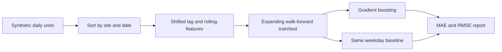

# Counterflow

### Can a model beat a sensible baseline without seeing the future?

Counterflow is a demand-forecasting benchmark I built around that question. It generates realistic-looking but entirely **synthetic** multi-site daily sales, creates past-only lag and rolling features, and uses expanding-history backtests to compare a gradient-boosted regressor with a simple same-weekday baseline.

**Core engineering:** deterministic data generation, validated site/day granularity, lag-1/lag-7/rolling-7/rolling-28 features, walk-forward splits by *calendar date* (not random rows), model vs baseline MAE and RMSE, reproducible JSON report.

## Run
```bash
python -m venv .venv && source .venv/bin/activate
pip install -e '.[test]'
python -m counterflow --report reports/generated/validation.json
pytest -q
```
The command prints an actual measured MAE for both approaches and writes fold-by-fold metrics; **no claimed percentage lift is baked into this README**. Your output is the benchmark result.

## How it works


## Known limits
Tests use observed history inside each evaluation window, so this is a **one-day-ahead historical simulation**, not a 14-day recursive production forecaster. Holidays, stockouts, returns, promos, drift, intermittent demand and prediction intervals are not implemented. A real rollout would add a proper feature store snapshot, point-in-time guarantees, model registry, automated retraining criteria and monitoring.
