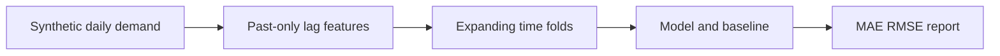

# Architecture and engineering decisions

> **Scope:** a local reference implementation using invented/synthetic inputs. No production deployment or service-level claims are implied.

## Demand forecasting without temporal leakage

**Actual processing path:** Seeded site-level synthetic sales --> Past-only lag/rolling features --> Expanding walk-forward folds --> Boosted regressor + weekday baseline --> Fold-level MAE/RMSE JSON.

## Key files

- `counterflow/pipeline.py`: deterministic data, validation, temporal features, fold training and metrics.
- `counterflow/__main__.py`: command-line report writer.

## Failure modes / trust boundaries

Past observations are available during each one-step evaluation; this is not an unattended multi-step forecast. Source data is synthetic and cannot establish commercial uplift.

## What I would build next

Holiday effects, hierarchical forecasts, multi-horizon evaluation, intervals, stockout-aware features.

## Reviewer checklist

1. Read the source and confirm the processing path above.
2. Follow `docs/DEMO.md` and run the tests locally.
3. Inspect CI and document any divergence between local and GitHub results.
4. Treat all benchmarks as synthetic demonstrations unless proven otherwise.
